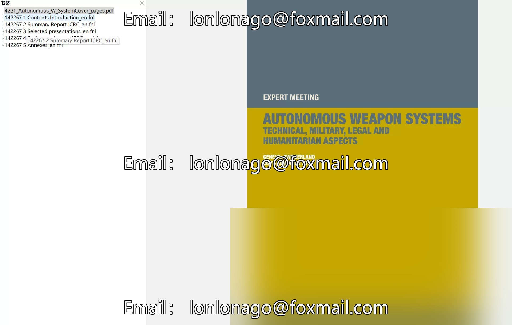
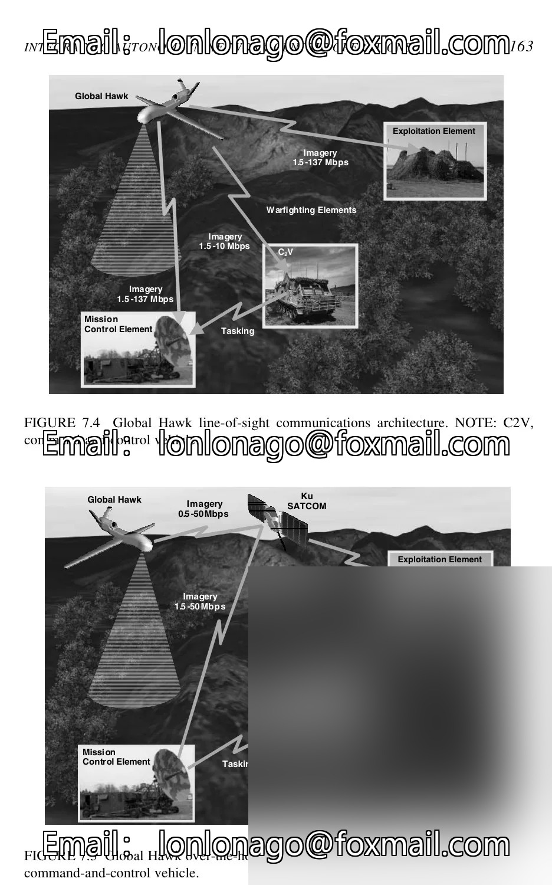
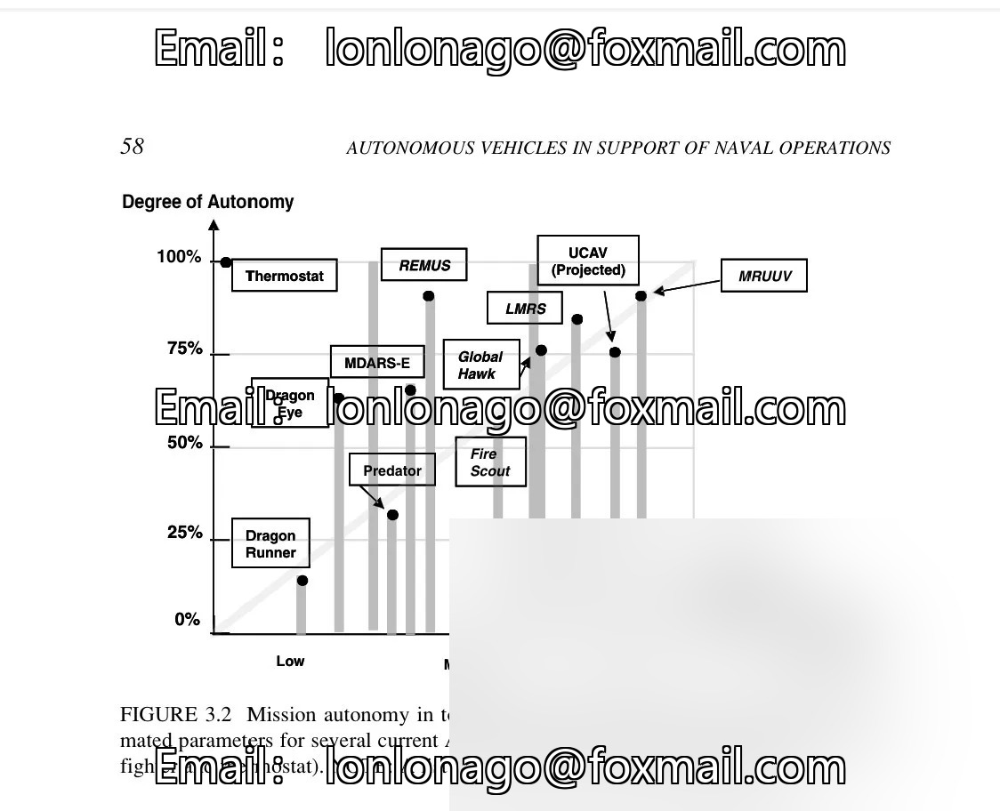

# "The Autonomous Weapon System: Technical, Military, Legal and Humanitarian Perspectives"

## Body

"Autonomous Weapon Systems: Technical, Military, Legal and Humanitarian Aspects"
(Autonomous Weapon Systems: Technical, Military, Legal and Humanitarian Aspects)
The expert conference report on autonomous weapon systems by the ICRC, a document of the 2014 Geneva Conference in Switzerland.
1. Meeting themes and content
1. Technical, military, legal and humanitarian aspects of autonomous weapon systems
2. Analysis of the global Eagle drone communication architecture
3. Application evaluation of autonomous vehicles in naval combat
4. Trends in future unmanned combat systems
2. Meeting outcomes

《Expert Meeting Summary Report》(Summary Report)
《Selected Presentation Packages》(Selected presentations)
《Annexes Data》(Annexes)
Three, Document Characteristics
Authority: Officially released by the International Red Cross
Comprehensiveness: Covers multi-dimensional analysis of technology, military, law, and humanitarian
Professionalism: Deeply explores the development trends of autonomous weapon systems
are replicable and returned upon sale.

This document covers technical, military, legal and humanitarian perspectives on autonomous weapon systems, including the ICRC expert meeting report, meeting outcomes, and document characteristics, along with relevant cover and content files.

<!-- AI_ENRICHED -->

## Images

## Payment

Here is a pay link on Stripe ( https://buy.stripe.com/3cs8yP7sY87d0vu9AB ). Please contact me lonlonago@foxmail.com after funding $89, and I will send you a complete data files , thank you!

